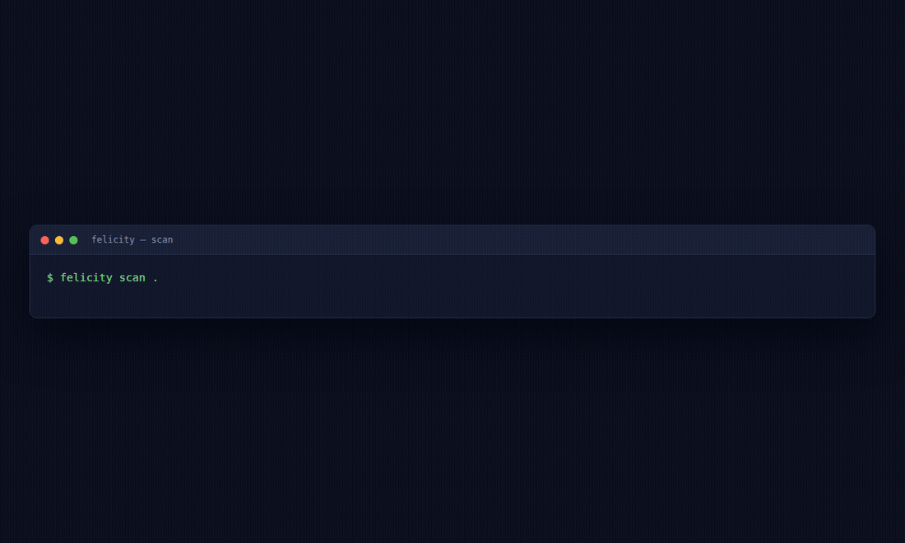

<p align="center">
  
</p>

# Shengcun

An offline-first security scanner for code, containers, infrastructure and the supply chain, **in
active development and working toward support for 45 languages.**

It reads a repository, a container manifest, a Kubernetes bundle, an IaC tree or a model file and
writes findings as SARIF 2.1.0 or a CycloneDX SBOM.

**Pure Python and pure Rust, nothing else.** The scanners are standard-library Python; the call-graph
engine, the isolation jails and the binary parsers are `std`-only Rust that builds to single static
files. No third-party packages, no crates, no package index, no network at scan time — it installs on
an air-gapped box and runs from a pre-commit hook.

**Shengcun is new.** It is still being built, it gets better every week, and eight fixes merged
upstream in its first week of hunting is the floor, not the ceiling.



---

## Proven in the wild

Shengcun is a tool being built, not a service being sold. While we build it, we point it at public
repositories several times a day on the side: to give back to the community, to train the engine on
real code, and because fixing a bug in someone else's workflow is the best marketing there is. These
are the first week's results.

| Date | Project | Finding | Status |
|---|---|---|---|
| 2026-11-20 | [calibrain/shelfmark](https://github.com/calibrain/shelfmark/pull/1718) | Untrusted book title reaches a shell invocation as syntax | ✅ Merged |
| 2026-11-20 | [cyruzzo/AboveVTT](https://github.com/cyruzzo/AboveVTT/pull/4997) | Pull request title interpolated into a shell command | ✅ Merged |
| 2026-11-20 | [CloudWaddie/LMArenaBridge](https://github.com/CloudWaddie/LMArenaBridge/pull/187) | Attacker-controlled cleanup targets in a CI step | ✅ Merged |
| 2026-11-19 | [com-lihaoyi/mill](https://github.com/com-lihaoyi/mill/pull/7956) | Draft status payload built by string concatenation instead of `jq` | ✅ Merged |
| 2026-11-18 | [Crequency/KitX](https://github.com/Crequency/KitX/pull/297) | PR title formatter executes its input | ✅ Merged |
| 2026-11-17 | [nrslib/takt](https://github.com/nrslib/takt/pull/2059) | Shell injection in the auto-tag workflow | ✅ Merged |
| 2026-11-16 | [sameerasw/my-internet](https://github.com/sameerasw/my-internet/pull/3513) | Shell injection in the Telegram notify workflow | ✅ Merged |
| 2026-11-16 | [sameerasw/airsync-mac](https://github.com/sameerasw/airsync-mac/pull/308) | Shell injection in the Telegram notify workflow | ✅ Merged |

A week of hunting looks like this: **39 reports opened, 8 merged, 21 waiting on review, 10 closed.**
The closed ones matter as much as the merged ones — a maintained rejection is a false positive we get
to fix, and every accepted fix becomes a regression test in this engine.

## What makes it different

**It fixes, and then proves the fix.** `shengcun fix --ai` takes a finding, builds a bounded prompt
around that finding only, suggests a patch and applies it — then re-scans the file and its neighbours.
If the finding survives, or a new one appears at the same severity or higher, or the file stops parsing,
the patch is reverted automatically. Bring your own model provider and key; the fixer never commits.

**It ships as two languages and no dependencies.** Python for the rules and the report, Rust for the
parts that must not be slow or must not be escapable — the graph, the sandbox, the binary parsers.
One `scp` to an air-gapped host and it works.

**It knows whether a dependency finding can actually be reached.** Advisories and exploit-likelihood
scores are joined against a real call graph, so "critical CVE in a library you import but never call"
stops outranking the live hole. The original severity is never overwritten — the adjusted verdict sits
beside it with the reason.

**It can prove what it saw and when.** Findings and reports are signable, so a client can verify that a
report has not been edited since it was produced and that a baseline entry was genuinely observed.
Tampered baselines are named, not averaged in.

## Coverage

- **Application code** — Python, JavaScript/TypeScript, Go, Rust, Ruby, PHP, Java, Kotlin, C#, Swift,
  Scala and C/C++, read from a parsed syntax tree rather than regular expressions, with cross-file data
  flow: a source in one file reaching a sink in another is a finding, not a miss. Unresolved calls are
  reported as unresolved rather than silently dropped.
- **Secrets** — signature families for cloud keys, platform tokens, private keys and connection
  strings, plus entropy analysis, optional read-only verification that a credential is live, and git
  history scanning for what has already been committed.
- **Infrastructure as code** — Dockerfile, Compose, Kubernetes, Terraform, CloudFormation-style
  templates, GitHub Actions and RBAC YAML, each with line-anchored findings.
- **Supply chain** — advisories resolved against the versions you actually pin, exploit-likelihood
  scoring, and a CycloneDX 1.5 SBOM using the same coordinates the findings cite.
- **Containers** — image and manifest posture, base-image drift, exposed runtime settings.
- **CI/CD** — workflow permissions, unpinned third-party actions, script injection through expression
  contexts — the class that produced every merged fix above.
- **Models and agents** — model-weight deserialization risks and unsafe loaders; agent and MCP
  configuration, over-broad tool grants, shell escapes and prompt-injection surfaces.
- **Compliance mapping** — findings carry their SOC 2, PCI DSS, HIPAA and CIS mappings.
- **External surface, authorization required** — attack-surface discovery, port probing and form
  auditing behind an explicit authorization flag and a scope check that fails closed.

## Review and remediation

- **Change-scoped scanning** — scan only what a branch touches, plus its call-graph neighbourhood, and
  flag code that becomes newly reachable.
- **Pull-request review** — one comment per PR with a computed verdict, not a wall of findings.
- **Pre-push gate** — fail the push that introduces a finding, without blocking legacy debt.
- **Impact tracing** — follow a leaked credential to where it actually goes, and how to revoke it.
- **History and metrics** — every finding tracked over time, with mean time to remediation by
  severity, rule and directory.
- **Policy as code and expiring suppressions** — per-client rules over findings in a small declarative
  file; every exception carries a reason and an expiry, and CI fails the day one lapses.
- **Baselines** — acknowledge what exists so the next run reports only what changed.

## Benchmarks

Django 5.1.4 source tree, 2,788 files, 71 MB, 8-core laptop, warm cache, median of two runs:

| Run | Time |
|---|---|
| Shengcun, full rule set, one process | **22.2 s** |
| Shengcun, full rule set, four processes | **13.0 s** |
| Shengcun, full rule set, seven processes | **8.6 s** |
| Shengcun, a 67-file service tree | **1.4 s** |

The same tree, same machine:

| Tool | Time | Scope |
|---|---|---|
| Bandit | 17.4 s | Python AST rules only |
| Semgrep (`p/default`) | 115.1 s | multi-language SAST rules |

Bandit is a good single-domain tool and beats one Shengcun worker by roughly 20% on that one job. The
difference is that Shengcun covers every domain on this page in a single pass, with nothing to install
and nothing that phones home.

## Runtime

| Piece | Language | Dependencies |
|---|---|---|
| Scanner, rules, SARIF, report | Python 3.10+, standard library only | none |
| Call-graph engine | Rust, `std` only | no crates, and no C toolchain for the shipped binaries |
| Kernel jail and KVM tier | Rust, `std` only | no crates |
| Binary and PE parsers | Rust, `std` only | no crates |

Linux, macOS and Windows. The static half needs no network and no package index; the Rust components
ship as single static files, so a target machine never needs a Rust toolchain.

## Outputs

- SARIF 2.1.0 for GitHub code scanning, Azure DevOps or any SIEM that speaks it.
- CycloneDX 1.5 SBOM.
- JSON, a console report, and a self-contained HTML report that can be white-labelled per client.
- Exit codes that distinguish clean, findings at or above threshold, usage error, target that could not
  be evaluated, and isolation unavailable — a broken scan never looks like a clean one.

```text
$ shengcun scan .

[CRITICAL] SEC-001 [CWE-798]: AWS Access Key ID Detected
  --> server/config.py:42:22
  Fix:  Store AWS credentials in IAM roles or environment variables.

[CRITICAL] AST-001 [CWE-78]: Command injection: subprocess with shell=True
  --> pipeline/run.py:115:5
  Fix:  Set shell=False and pass an argument list.

[CRITICAL] IAC-TF-001 [CWE-284]: Security group ingress open to 0.0.0.0/0 on port 22
  --> infra/main.tf:18:5
  Fix:  Restrict cidr_blocks or move behind a bastion.

Scan Summary: 3 CRITICAL | 0 HIGH | 0 MEDIUM | 0 LOW
```

## Status

**In active development, private beta.** The scanner is the work; the upstream reports are what it does
on the side — a handful of repositories a day, to give back, to train the engine on real code and to
get the name known. Every accepted fix becomes a regression test here, which is why this project is
already better than it was last week and will be better again next week.

When it ships:

- **Shengcun Lite** — free and open source under **AGPL-3.0**.
- **The full edition** — a proprietary SaaS with the isolation tiers, the review and remediation
  surfaces, compliance mapping and support.

Shengcun is **not publicly available today**. Access is limited to selected demos for teams we are
working with, until those two releases land.

## Get in touch

Want to see it run against your codebase? That is the fastest way to judge it.

- **Email** — [business@rs-systems-web.com](mailto:business@rs-systems-web.com?subject=Shengcun%20demo%20request)
- **Telegram** — [@RS_SYSTEMS](https://t.me/RS_SYSTEMS)
- **Discord** — `happypower1k`

Want a note when it ships, or when the set of findings it detects changes?
[Get emailed alerts](https://alerts.rs-systems-web.com/).
