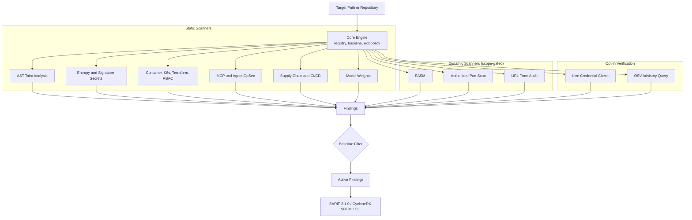

# Shengcun

**An offline-first security scanner for code, containers, infrastructure and the supply chain.**

Shengcun is a single Python command that reads a repository, a directory, a container manifest, a
Kubernetes bundle, an IaC tree or a model file, and writes findings as SARIF 2.1.0 or a CycloneDX
SBOM. It runs with no network by default: the static scanners only ever read bytes on disk.

Shengcun is **in development, and this repository is its public showcase**. A lite edition is being cut
for release under AGPL-3.0 and ships shortly; the full edition launches as a proprietary SaaS.

The source is not published here yet. This page carries the architecture, the measured numbers and the
coverage; if you want to see it run against your codebase, [request a demo](#request-a-demo).

---

## Why it exists

A normal repository review needs six or seven tools: a SAST engine, a secrets scanner, an IaC linter,
a container checker, a dependency audit, a workflow audit and something for the new class of agent
and MCP findings. Most teams run two of them, because every extra tool is another install, another
config file, another output format and another source of noise.

Shengcun is one binary, one exit code, one report, with a baseline so the second run only shows what
changed. Everything is standard library Python with zero third-party dependencies, so it installs in
seconds and runs on an air-gapped host.

---

## Architecture



An offline scan never leaves the machine. The three dynamic entry points, credential verification and
the OSV query are the only code paths that open a socket, and each one is invoked by an explicit flag
or command.

---

## What it covers

35 scanner modules, each owning one domain:

| Domain | Modules |
| --- | --- |
| Code and taint | `ast_visitor`, `taint`, `interprocedural`, `sast`, `lang_rules`, `graph_markers` |
| Secrets | `secrets`, `secret_verify` |
| Containers and infrastructure | `container_iac`, `k8s_manifest`, `iac`, `systrap`, `priv_esc` |
| Supply chain | `supply_chain`, `osv`, `git_history`, `cicd_workflow` |
| Agent and AI surfaces | `mcp_security`, `agent_opsec`, `prompt_surfaces`, `model_weights` |
| Untrusted artifacts | `binary`, `pickle_inspector`, `malware_behaviour`, `legacy_source`, `repo_traps` |
| Network and exposure (gated) | `easm`, `active_port`, `network_opsec`, `url_audit`, `url_pentest`, `web_auth`, `dynamic` |
| Sandbox and enforcement | `hwjail` (hardware jail), licensing and exit policy in `core` |

Findings carry a severity, a file and line, a rule id and a remediation hint, and the same finding is
reported once whether it is reached by the AST pass, the taint pass or a language rule.

---

## Penetration testing, both directions

**Static, inside the code.** The scanner reads a repository the way a reviewer would: AST and
interprocedural taint tracing from source to sink, dangerous-call and deserialization rules, entropy
and signature secrets, IaC and CI misconfiguration. That is code-level pen testing with nothing
executed — it finds the path an attacker would take before anything runs.

**Black-box, against a URL you are authorised to test.** The dynamic half is in the engine, not on a
roadmap:

- `shengcun easm <url>` — external attack surface: DNS, TLS, headers, exposed endpoints, and whether
  the host resolves to a known C2 seed (`EASM-C2-BEACON`).
- `shengcun url-audit <url>` — enumerates every form a live page publishes (action, method, fields)
  and audits the client-side posture.
- `shengcun url-pentest` (`shengcun/scanners/url_pentest.py`) — replays those forms with unique marker
  payloads and judges what comes back: reflected XSS, encoded reflection, error-signature leakage and
  potential blind SQL injection.
- `shengcun active-port <host>` — authorised high-value port scan with banner grabbing.

The constraints are deliberate: every outbound request is checked against the scope you declared,
rate-limited, one request per call, never brute-forced, and non-destructive by construction — it
moves bytes and reports reflections, it does not write payloads into a target. Probing a host you do
not own or have written permission to test is a criminal act in most jurisdictions; the scope parser
exists to enforce the boundary you set.

## Measured runtimes

The same 100 Python files, one process, on an 8-core laptop, wall clock:

| Tool | Time | Findings | Scope on that corpus |
| --- | --- | --- | --- |
| **Shengcun** | **8.3 s** | 62 | Python code plus secrets, dependencies, CI config and repo traps in one pass |
| Bandit | 4.1 s | 145 | Python AST security rules only |
| Semgrep (`p/default`) | 44.6 s | 24 | SAST rules only |

Read that table for what it is: Bandit is faster because it does one thing over one language, and
Semgrep is slower because it loads a large rule pack. The finding counts are not a quality ranking —
they count different things, and a rule that fires on `subprocess` and a rule that fires on an
unpinned container digest are not comparable. The point is that Shengcun's breadth costs seconds, not
minutes, so it can sit in a pre-commit hook.

Larger runs, measured on a 2,788-file repository: 22 s single process, 8.6 s across seven workers.

---

## Output

```bash
shengcun scan . --sarif -o results.sarif     # SARIF 2.1.0, drops straight into GitHub code scanning
shengcun scan . --json -o results.json       # machine-readable findings
shengcun scan . --create-baseline base.json  # pin today's findings
shengcun scan . --baseline base.json         # report only what is new since then
shengcun scan . --fail-level HIGH            # exit non-zero on a high or critical finding
```

Deterministic ordering, stable rule ids and a baseline that survives refactors are the reason it can
run on every commit without becoming background noise.

---

## Request a Demo

Shengcun is available for evaluation and licensing. If you want a walkthrough, a scan of your own
repository, or the SARIF output wired into your pipeline:

- **Request a demo:** email [business@rs-systems-web.com](mailto:business@rs-systems-web.com?subject=Shengcun%20demo%20request) with the repository you would like scanned and its language mix, and you will get a time back by reply.
- **Commercial licensing and questions:** RS Systems — [rs-systems-web.com](https://rs-systems-web.com)

---

## Licence

This showcase repository — its text, diagrams and tables — is licensed under the GNU Affero General
Public License v3.0. See [LICENSE](LICENSE). Shengcun Lite will be released under the same licence.
The full Shengcun edition is proprietary SaaS and is not distributed here; the AGPL above covers this
repository's contents only.

Copyright (c) RS Systems.
